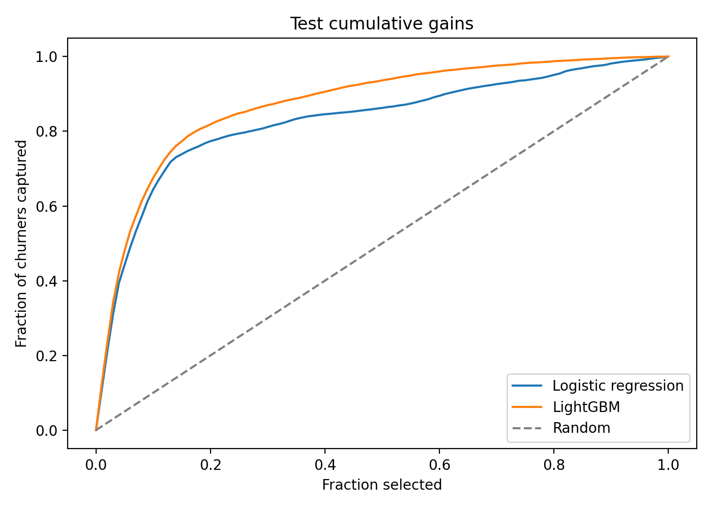
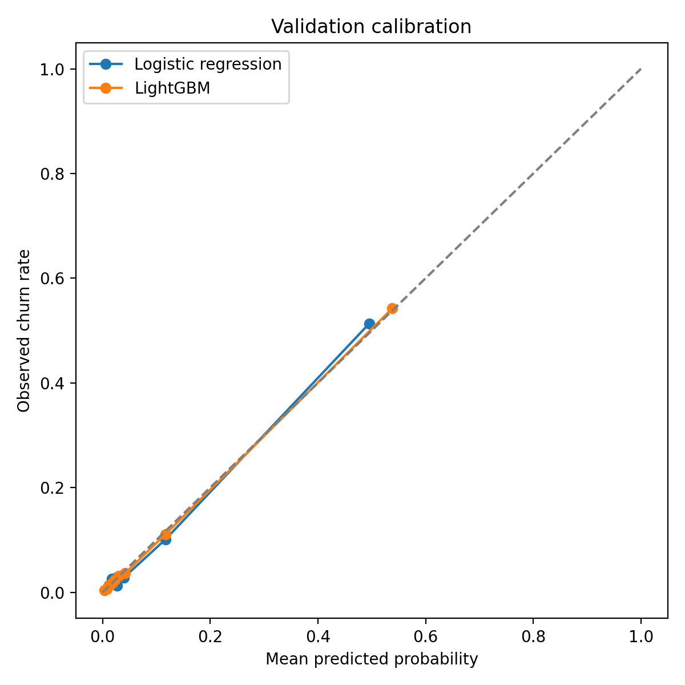
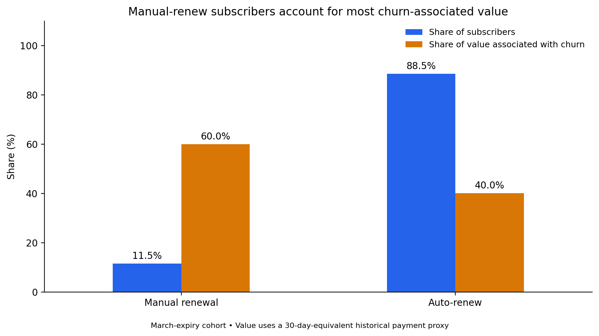

# KKBox Churn: Revenue & Operations Strategy

**With a fixed retention budget and limited contact capacity, which expiring subscribers should KKBox contact to protect the most subscription value?**

This project turns a churn model into a retention decision. In a historical test cohort of 188,304 subscribers, contacting only those with positive expected benefit selects **12,644 subscribers** and yields **NTD 53,661 in modeled net value after contact costs**. Filling the full 18,831-contact capacity yields NTD 47,663. Under the stated assumptions, that is **12.6% more expected net value with 32.9% fewer contacts**.

The scenario assumes a **10% relative churn reduction** and **NTD 5 per contact**. These are modeled returns, not measured campaign outcomes or profit.

**Read:** [Executive memo](reports/executive_memo.md) · [Two-page PDF](reports/executive_memo.pdf) · [Operations and KPI specification](docs/kpi_dashboard_spec.md)

## The decision

```text
Value at risk = predicted churn probability × 30-day-equivalent payment value
Expected net benefit = assumed relative churn reduction × value at risk − contact cost
```

Rank subscribers by expected net benefit, contact only those above zero, and stop at the capacity limit. Under the central assumptions, this means selecting subscribers with predicted value at risk above NTD 50. Uniform effectiveness and cost are assumptions; the model does not estimate treatment effects.

| Test-cohort policy | Contacts | Contact cost (NTD) | Expected value protected (NTD) | Expected net (NTD) |
|---|---:|---:|---:|---:|
| Fill capacity, ranked by value at risk | 18,831 | 94,155 | 141,818 | 47,663 |
| Positive expected benefit only | 12,644 | 63,220 | 116,881 | **53,661** |

The smaller list captures 55.32% of observed churn-associated payment value, versus 68.15% for the full-capacity list. It trades some coverage for higher modeled net value. Observed churn-associated value is not money recovered by outreach.

## Model performance

| Model | Test log loss ↓ | Test ROC AUC ↑ | Churners captured in highest-risk 10% | Lift |
|---|---:|---:|---:|---:|
| Logistic regression | 0.1777 | 0.8578 | 64.49% | 6.45× |
| LightGBM | **0.1554** | **0.9068** | **67.54%** | **6.75×** |

The 941,518-subscriber campaign cohort is split 60%/20%/20% into training, validation, and test groups. Preprocessing is fitted on training data; validation controls early stopping. This is a same-period subscriber split, not a future-month evaluation.





Calibration is checked because the strategy multiplies probabilities by payment value. SHAP identifies auto-renew status, transaction recency, payment method, observed history length, and plan price among the strongest model drivers. These are predictive associations, not causal effects.

## Business findings

- **Manual-renew subscribers concentrate churn-associated value:** 11.48% of the cohort accounts for 57.95% of churners and 59.96% of standardized payment value associated with churn.
- **The renewal-setting gap persists within 30-day plans:** manual-renew churn is 28.55%, versus 3.78% for auto-renew.
- **Cancellation status identifies a high-risk group:** among auto-renew subscribers, churn is 70.78% with a latest cancellation record versus 3.51% without one.
- **Plan duration changes the value interpretation:** latest-payment-weighted churn is 19.86%; 30-day-equivalent weighted churn is 8.59%.
- **Discount evidence is limited:** only 690 subscribers fall in positive-payment partial-discount bands, providing insufficient causal evidence for expanding discounts.



## Economics and validation plan

The value proxy is `latest actual amount paid × 30 / latest plan days`, in **NTD**. Zero payments retain zero value; nonpositive duration produces unknown value. Two campaign subscribers have unknown value; neither is in the strategy test cohort. The proxy is not accounting MRR, lifetime value, or a verified next-payment forecast.

For the fixed 12,644-person test list at NTD 5 per contact, expected net value ranges from **−NTD 4,780 at 5% relative churn reduction** to **NTD 170,542 at 20%**. Break-even is approximately **5.41%**. This is an assumption range, not a confidence interval; the list remains fixed at the selection made under the 10% assumption. The notebook also compares random, churn-probability, and value-at-risk targeting across costs of NTD 1, 5, and 10.

The recommendation is to **pilot positive-benefit targeting**, test **consent-based auto-renew assistance**, and test **discounts against otherwise identical outreach without incentives**. An illustrative retention pilot requires about 847 subscribers per arm to detect a 10% relative churn reduction from a 65.85% control churn rate, at 80% power and a two-sided 5% significance level. The proposed starting allocation is 1,000 per arm, subject to confirming the population and delivery assumptions. Incremental revenue and costs must be measured alongside retention.

See the [memo](reports/executive_memo.pdf) for the decision and the [KPI specification](docs/kpi_dashboard_spec.md) for scheduling, ownership, experiment measurement, and monitoring.

## Data and methods

Source: [Kaggle's WSDM - KKBox Churn Prediction Challenge](https://www.kaggle.com/competitions/kkbox-churn-prediction-challenge/data). Download the files through Kaggle under its applicable terms; raw subscriber data is not distributed here.

| File | Use |
|---|---|
| `train_v2.csv` | Supplied March-period churn labels |
| `transactions.csv` | Transaction history through February 28, 2017 |
| `members_v3.csv` | Member attributes and registration information |
| `transactions_v2.csv` | Optional diagnostics only; excluded from model inputs |

Features use transactions dated on or before February 28, 2017. Campaign eligibility requires an unambiguous latest pre-cutoff subscription state expiring in March. Supplied labels are not independently reconstructed against each selected expiry date. The 970,960-person label population has 8.99% churn; the campaign subset has 7.97%.

Preparation masks invalid ages and future registration dates for tenure, handles missing member records explicitly, excludes ambiguous latest states from campaign eligibility, and processes transaction history in chunks. The 21 model features are documented in the [feature dictionary](docs/feature_dictionary.md). The [methodology notes](docs/review.md) explain source selection, exclusions, and evaluation limits.

## Reproduce

The author's successful local run used Python 3.9.6, pandas 2.3.3, and NumPy 2.0.2. Other dependency bounds in `requirements.txt` are compatibility ranges; an exact environment lock has not been published.

1. Put the required CSVs in `Data/Raw/`. Alternatively, edit `raw_data_dir` in `config.json`.
2. From the repository root, install dependencies in a virtual environment:

   ```bash
   python3 -m venv .venv
   source .venv/bin/activate
   python -m pip install -r requirements.txt
   python -m ipykernel install --user --name kkbox --display-name "Python (KKBox)"
   ```

3. Select **Python (KKBox)** in VS Code and run notebooks **01 → 02 → 03 → 04**, each from a fresh kernel. On macOS, LightGBM may require the OpenMP runtime (`brew install libomp`).
4. Alternatively, run `python scripts/run_all.py --kernel kkbox` after registering that kernel. See [local execution instructions](docs/local_run_checklist.md) for checks and environment capture.

| Location | Contents |
|---|---|
| `notebooks/` | EDA, features, model evaluation, strategy simulation |
| `src/` | Reusable data, feature, and strategy functions |
| `reports/` | Memo, aggregate tables, and figures |
| `docs/` | Methodology, feature definitions, validation, and operations |
| `scripts/` and `tests/` | Execution, optional diagnostics, and focused tests |

Intermediate tables and subscriber predictions are saved locally in ignored directories. Notebooks 02–04 currently omit saved outputs; their aggregate results are available in `reports/tables/` and `reports/figures/`.

## Limitations

- Historical 2015–2017 data demonstrates a method, not current KKBox performance.
- Member snapshot availability and historical-dated records in the later transaction release cannot be fully verified at the scoring cutoff.
- Eligibility excludes ambiguous and missing subscription states; conclusions apply to the selected cohort.
- Full-cohort EDA preceded splitting, and test results were inspected during development. This is not a pristine prospective or future-month evaluation.
- Intervention effectiveness is assumed. Incentives, service costs, margins, and longer-term retention are excluded from the scenario economics.

[Validation record](docs/validation_report.md)
